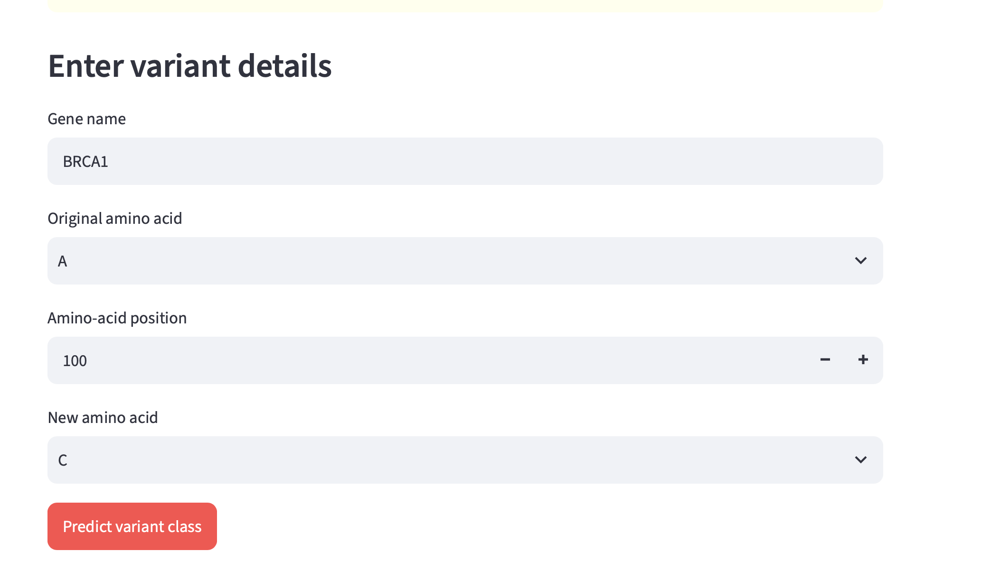
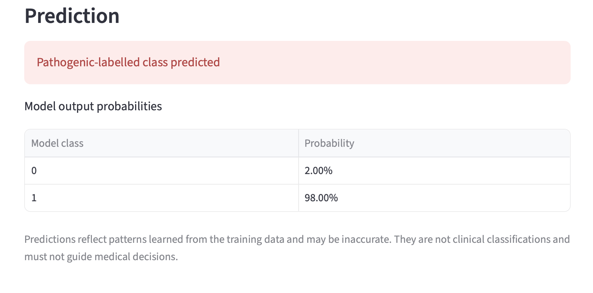

# VariantAI: An Explainable Machine Learning Framework for Protein Variant Pathogenicity Prediction

## Overview

VariantAI is a research and educational prototype that explores the use of machine learning to classify protein amino-acid variants as pathogenic-labelled or benign-labelled. The application uses variant features and a Random Forest classifier through an interactive Streamlit interface.

## Objectives

- Explore machine learning for protein variant classification.
- Use amino-acid substitutions, residue positions, and gene information as model features.
- Present predictions through a simple web application.
- Explore model interpretability using feature importance.

## Technologies Used

- Python
- Pandas and NumPy
- Scikit-learn
- Random Forest
- Joblib
- Streamlit
- ClinVar variant data

## Application Inputs

- Gene name
- Original amino acid
- Amino-acid position
- New amino acid

## Installation

1. Clone or download this repository.
2. Create and activate a Python virtual environment.
3. Install the dependencies:

   ```bash
   pip install -r requirements.txt
   ```

4. Place the trained model at `models/variantai_model.pkl`.
5. Run the application:

   ```bash
   streamlit run app.py
   ```

## Model

The prototype uses a Random Forest classifier with categorical and numerical features. Model performance should be evaluated using appropriate metrics, including precision, recall, F1-score, balanced accuracy, and ROC-AUC.

## Limitations

This is an educational research prototype, not a clinically validated pathogenicity predictor. Performance may be affected by class imbalance, data quality, gene overlap, and dataset construction. Predictions must not be used for diagnosis or clinical decision-making.

## Disclaimer

For research and educational use only. VariantAI predictions are not clinical diagnoses or independently validated clinical classifications.

## Application Screenshots

### Variant Input Interface



### Prediction Results


